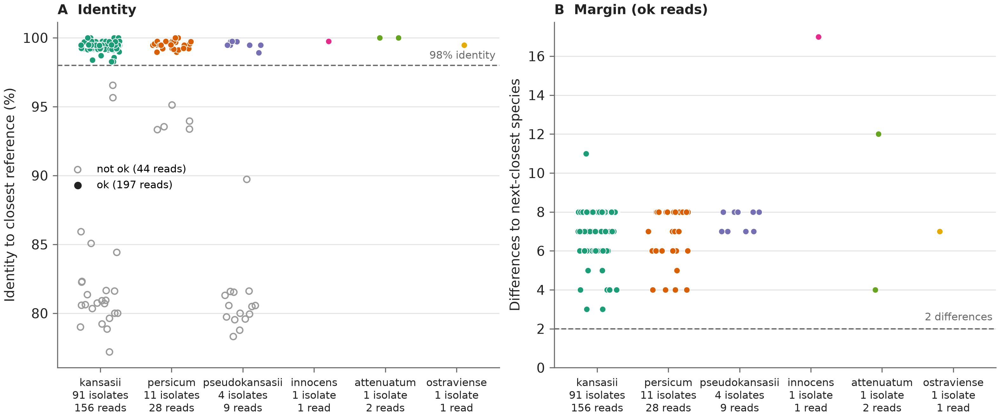
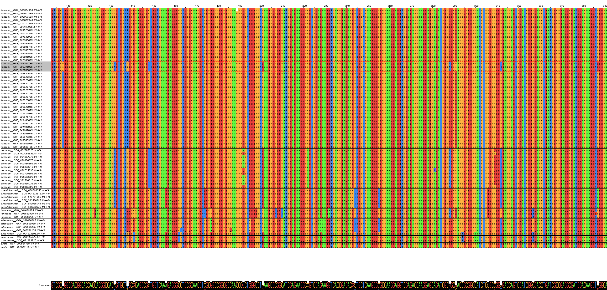

# A single hsp65 Sanger read differentiates the species of the *Mycobacterium kansasii* complex

*Draft, 2026-10-16. Numbers come from `output/hsp65_refalign/` (this repo) and from the reference-level analyses of mlsa-kansasii (`output/mlsa/locus_discovery*`, `sanger_vs_wgs`). Authors and affiliations to be added. Merged on 2026-10-19 with the earlier mlsa-kansasii draft (`hsp65_sanger_identification.md`, 2026-10-09); its routine-use material is section 5. Numbers in section 5.3 come from that earlier analysis (126 isolates) and have not been recomputed on the current cohort.*

## Abstract

**Background.** The *M. kansasii* complex comprises at least seven species (*kansasii*, *persicum*, *pseudokansasii*, *innocens*, *attenuatum*, *ostraviense*, *gastri*) that differ in clinical relevance and drug susceptibility. Diagnostic laboratories commonly identify them by Sanger sequencing of a 441 bp hsp65 (groEL2) fragment. Recent genomic work has questioned whether hsp65, or any classic marker, is sufficient.

**Methods.** We tested hsp65 against whole-genome species (GTDB-Tk) in two ways. At reference level, we measured how many of the 21 species pairs hsp65 separates in 72 public genomes. In the clinical setting, we aligned every routine hsp65 Sanger read of 136 genome-typed isolates to one reference genome per species and called the species with the fewest differences, requiring at least 98% identity and at least two differences fewer than the next species. Three contaminated isolates were excluded.

**Results.** hsp65 separated 21 of 21 species pairs once three near-clonal genomes carrying an atypical hsp65 were set aside (within-species divergence up to 0.45%, between-species at least 1.36%). A perfect read (hsp65 extracted from each assembly) gave the genome species for 174 of 174 uncontaminated isolates. Of 132 analysed isolates, 108 received a call and **all 108 were correct** (197 of 197 individual reads; the 72 isolates with two or more callable reads never disagreed). In 880 public GTDB-*kansasii* assemblies, 1 carried the persicum-like hsp65 and 2 an hsp65 identical to another species. The remaining 24 isolates got no call, and in none of them did a callable read point to the wrong species: 13 carried clean reads of *Rothia mucilaginosa*, 10 only unusable traces, and 1 only poor reads.

**Conclusion.** One good hsp65 read, interpreted by best match and margin rather than by a fixed identity cutoff, identifies the species of the *M. kansasii* complex. Failures are failures of the read, not of the marker, and are detectable by the same rules that make the correct calls.

## 1. Introduction

*M. kansasii* was long treated as one species with hsp65 PCR-restriction subtypes I to V [Picardeau 1997; Alcaide 1997]. Phylogenomics showed that the subtypes are separate species, with ANI between them of 88.4 to 94.2%, below the species cut-off [Tagini 2019], and *M. gastri* sits inside the group. Identification matters because the species differ in clinical relevance and resistance profile, and gastri and kansasii cannot be told apart by 16S, which is identical in them [Richter 1999]. Hsp65 sequencing on the 441 bp Telenti fragment [Telenti 1993] has been the routine alternative, with sequence databases and a 97% identity rule [McNabb 2004; Kim 2005]. Against this, a genomic study concluded that none of 16S, hsp65, rpoB, tuf and ITS distinguishes all species and recommended whole genomes [Jagielski 2019].

We argue that this conclusion is true for a fixed identity threshold and for the full set of public genomes taken at face value, but not for what a laboratory actually does with a read: align it, take the closest species and require a margin. We test that on genomes and on twelve years of routine reads (2014 to 2026).

## 2. Methods

**Truth.** Whole-genome species (GTDB-Tk, release 232 genomes as reference) of 177 clinical isolates in the complex, sequenced on Illumina and assembled with Unicycler (the screening table holds 186 isolates; the 8 reference strains Mkan329-126 to -133 and one non-complex patient isolate are not counted). CheckM contamination above the lab's flag marks an isolate as contaminated (Mkan329-035, -106, -113); these are excluded because a mixed sample has no single species.

**Reference level.** hsp65, 16S, ITS and six further loci were extracted from 72 GTDB genomes of the seven species. A pair of species is separated if the largest within-species distance is smaller than the smallest between-species distance (DNA-barcoding gap). We ran this with all genomes and without three Korean kansasii genomes (GCF_002705785.1, -825.1, -865.1) that carry a persicum-like hsp65 (see Discussion).

**Clinical reads.** All hsp65 `.ab1` traces in the lab archive (2014 to 2026; primers TB-11 and TB-12w) were quality-trimmed (modified Mott), assigned to their isolate through every TNR recorded for it, and aligned to one reference genome per species. Seeds of exact 15-mers locate the best window and a global alignment counts differences over the read. The call is the species with the fewest differences. A read is **ok** if its identity is at least 98% and the next-closest species has at least two more differences. An isolate is correct if it has at least one ok read and every ok read names the genome species. Reads without an ok call were also aligned to the isolate's own assembly; below 90% identity the read does not come from that genome. Two non-matching reads, one per sequence group, were identified by BLAST against NCBI core_nt.

**Public genomes.** To see whether the atypical lineage occurs outside the Korean study, the hsp65 amplicon (TB-11 / TB-12w, TB-12 as fallback, up to three mismatches per primer) was cut in silico from the Unicycler assemblies of the public BioProjects PRJNA1078897, PRJNA1048499, PRJNA845115 and PRJNA323639, for the 880 samples that GTDB-Tk calls *M. kansasii*, and classified against the 72 per-genome amplicons with the same rules. The three Korean genomes are separate references, so a closest hit to one of them marks the atypical lineage. As a positive control the first three GTDB-*persicum* samples of each of three projects were run the same way.

**Ceiling.** To separate failures of the assay from limits of the marker, the hsp65 amplicon was also extracted in silico from each isolate's own assembly and classified with the same rules.

The code is `scripts/01_validate_hsp65_refalign.py`, `02_blast_reads.py`, `04_korean_type_check.py` and `05_call_public.py`; the alignment module is vendored from mlsa-kansasii.

## 3. Results

### 3.1 At reference level hsp65 separates all species except through one lineage

| Locus | Species pairs separated (of 21) |
|---|---|
| gyrA, gyrB, rpoB, recA, tuf | 21 |
| **hsp65** | **17 (21 without three Korean genomes)** |
| ITS | 16 |
| 16S | 12 |
| secA1 | 6 |

All four failing hsp65 pairs involve the same three near-clonal genomes (kansasii with gastri, ostraviense, persicum, pseudokansasii). Figure 2 shows them in the hsp65 alignment. Without them, the largest within-species distance is 0.45% and the smallest between-species distance 1.36% over 441 bp, a gap of about 4 nucleotides. With them, within-kansasii divergence is 2.5%, which swallows the gap. 16S, in contrast, fails for reasons that no genome choice removes: several species have identical 16S sequences.

### 3.2 A perfect hsp65 read identifies every isolate

For all 174 uncontaminated isolates the in-silico amplicon had status ok and named the genome species (122 kansasii, 29 persicum, 19 pseudokansasii, 2 attenuatum, 1 innocens, 1 ostraviense). The amplicon was identical to its closest reference in 165 isolates, differed by one base in 4 and by two in 5. The closest other species was at least 4 differences further away (median 8). In particular, all 122 uncontaminated kansasii isolates had kansasii as the closest species (121 identical to the reference, one with one difference), so none carries the persicum-like hsp65 of the Korean kansasii genomes (section 4).

### 3.3 Real Sanger reads: no call is common, a wrong call did not occur

Of 136 isolates with a Sanger hsp65 read, 132 remained after excluding contamination (Mkan329-021, -035, -106, -113).

| Outcome | Isolates |
|---|---|
| Called, correct | **108** (kansasii 90, persicum 11, pseudokansasii 4, attenuatum 1, innocens 1, ostraviense 1) |
| Called, wrong | **0** |
| No call, reads are *Rothia mucilaginosa* | 13 |
| No call, only empty or very short traces | 10 |
| No call, only poor reads (93 to 94% identity) | 1 |

**Figure 1.** Each point is one hsp65 read of an uncontaminated isolate, grouped by genome species. **A**, identity to the closest reference; filled points are `ok` reads (coloured by species), open grey points are reads without a call (44 reads: *Rothia*, poor and failed reads). **B**, number of differences between the closest and the next-closest species, for `ok` reads. Dashed lines are the calling thresholds. The two groups are separated by a gap: every `ok` read is at 98.26% or above, no other read exceeds 96.55%, and the smallest margin is 3 differences.

The 108 correct isolates had 195 ok reads (median 379 bp, 99.5% identity, median margin 8 differences, minimum 3). All 195 named the genome species. For the 71 isolates with two or more ok reads (forward and reverse, or repeats) the reads never disagreed.

### 3.4 What the 24 no-calls are

Thirteen isolates have clean traces that match no kansasii-complex reference (about 80% identity) and also not the isolate's own genome (75 to 80%). The reads form two sequence groups, one of 16 reads from 9 isolates sampled between 2015 and 2026 (94 to 100% identical), one shared by Mkan329-007 and -178. BLAST of one read per group gave ***Rothia mucilaginosa*, 98.9% and 97.6% identity over the whole read**. Rothia is an oral commensal, so a respiratory culture or specimen can plausibly carry it, and the TB-11/TB-12w primers evidently amplify its hsp65; we did not trace the source. The genomes of these isolates are clean (CheckM at most 3.3%) and their 16S and other reads match the complex species, so the culture is right and the hsp65 read is a contaminant read. The rules reject such reads without help: the identity is nowhere near 98%.

Ten isolates have only empty or sub-100 bp traces, and one (persicum) only reads at 93 to 94%. All 24 are cases for repeating the PCR.

### 3.5 Public genomes: the atypical lineage is rare but not confined to the Korean study

An amplicon was found in all 880 GTDB-kansasii samples. 877 are closest to a typical kansasii reference, each with 0 differences. Three are not:

| Sample | BioProject | Closest hsp65 reference (differences) | Best typical kansasii reference (differences) | Note |
|---|---|---|---|---|
| SRR28038296 | PRJNA1078897 | atypical kansasii genome GCF_002705785.1 (0) | same genome | persicum is 1 difference behind: ambiguous, a read would be called persicum |
| SRR27048434 | PRJNA1048499 | *pseudokansasii* GCA_000524055.1 (0) | 11 | next: gastri 10, persicum 12 |
| SRR27048675 | PRJNA1048499 | *attenuatum* GCA_002086865.1 (0) | 15 | next: gastri 14, persicum 16, pseudokansasii 16 |

So 1 of 880 (0.1%) has the persicum-like hsp65 of the Korean genomes, and no sample is closest to a persicum reference. The other two are kansasii by every other measure (GTDB-Tk ANI to the type strain 99.59% and 99.88%, next species below 94%; 16S kansasii; CheckM contamination 0.15%) but carry an hsp65 identical to that of *pseudokansasii* and *attenuatum*; a Sanger hsp65 read would call them those species. We did not establish whether these are real hsp65 transfers or assembly artefacts, and did not map reads to the amplicons to look for mixed bases. The positive control behaved as expected: of nine GTDB-*persicum* samples, six were closest to a persicum reference (status ok) and three to the atypical kansasii genome (ambiguous, persicum one difference behind), so all nine were flagged persicum-like. Not covered are the 184 public samples without a kansasii GTDB call, one sample without an assembly and the in-house isolates (section 3.2).

## 4. Discussion

**Why hsp65 works here although "no marker distinguishes all species".** The statement of Jagielski et al. [2019] compares markers across species at the level of fixed thresholds and public genomes. We find two things that matter in practice. First, the marker fails through one identifiable lineage, not diffusely. Second, the call needs the best match and its margin, not an identity cut-off: kansasii and gastri are about 98.4% identical in hsp65, so a rule such as at least 97% [McNabb 2004] accepts both, whereas the closest species with a margin of at least two differences does not.

**The atypical lineage is real but absent from our isolates and rare in public data.** The three Korean genomes are *M. kansasii* by ANI (98.5 to 99.3% to other kansasii, at most 94% to any other species) and identical to the type strain at gyrA, rpoB, 16S and other loci, yet carry a persicum-like hsp65 (11 SNPs in the amplicon; the "atypical hsp65 types" of Jagielski et al.). The alignment of the GTDB genomes (Figure 2, species in the order kansasii, persicum, pseudokansasii, innocens, attenuatum, ostraviense, gastri) shows that the Korean samples are the exception: every other genome groups with its species, whereas these three kansasii genomes differ from the other kansasii and follow the persicum pattern. The Korean amplicon is 1 to 3 differences from the persicum genomes, overlapping the 0 to 2 differences seen among persicum genomes themselves, so an hsp65 read of such a strain would be called persicum and the margin rule cannot separate the two; gyrA does. None of our isolates behaved like this. Among the 122 uncontaminated isolates that are *M. kansasii* by genome, the in-silico amplicon had kansasii as the closest species in all 122, identical to the kansasii reference in 121 and one base away in the other, so none is persicum-like. Laying the Korean amplicon directly over each assembly (`04_korean_type_check.py`) confirms it: the closest kansasii isolate is 10 differences away, and none of the 122 is closer to the Korean amplicon than to the kansasii reference. This covers the whole cohort, not only the 108 isolates with a callable Sanger read. Public data show the lineage outside the Korean study, but rarely: 1 of 880 GTDB-kansasii public assemblies (section 3.5), and two further samples whose hsp65 matches another species. We therefore claim that hsp65 differentiates the complex, and not that it is infallible.

**Figure 2.** Alignment of the hsp65 amplicon of the GTDB genomes of the *M. kansasii* complex. Black lines separate the species, from top to bottom *kansasii*, *persicum*, *pseudokansasii*, *innocens*, *attenuatum*, *ostraviense* and *gastri*. The three highlighted *kansasii* rows are the Korean genomes (GCF_002705785.1, GCF_002705825.1, GCF_002705865.1); they differ from the other *kansasii* genomes and carry the *persicum*-like pattern, so they are the exception.

**A second locus is a confirmation step, not a replacement.** gyrA, gyrB, rpoB, recA and tuf each separate all 21 pairs and would be better markers if one had to choose from scratch. The point is that hsp65 is already sequenced routinely, has a large reference base, and reaches the same answer on every isolate where a usable read exists. Adding gyrA is appropriate when the read hits the atypical lineage, the margin is below two, or the result must be certain for reporting.

**Mixed cultures and contaminant reads are visible.** The one discordant isolate in the data, Mkan329-035, is a mixed culture (kansasii and ostraviense, CheckM 113%); hsp65 correctly reported the dominant ostraviense component. Mixed templates can show as secondary peaks in the trace, and the *Rothia* reads were rejected by the identity rule.

**Limits.**
- The clinical set comes from one laboratory and is dominated by kansasii (104 of 132). The rarer species are represented by few isolates (pseudokansasii 13, persicum 12, innocens 1, attenuatum 1, ostraviense 1), and gastri has none; for it the claim rests on 2 reference genomes.
- The truth is the genome species. Isolates in which the genome and the Sanger sample could differ were handled only through the contamination flag and the own-genome check.
- Eighteen percent of isolates (24 of 132) had no usable call. A diagnostic claim has to include that the assay must be repeated for roughly one isolate in six.
- The rules were fixed on the same archive they are tested on, and the thresholds (98% identity, margin of two) were chosen on this data. A prospective batch is needed.
- The absence of the persicum-like kansasii hsp65 holds for this one-laboratory cohort; the lineage occurs elsewhere (1 of 880 public GTDB-kansasii assemblies), so other laboratories may meet it.
- The public-genome result (section 3.5) uses in-silico amplicons from assemblies, not Sanger reads, and the 3 discordant samples were not checked at read level. Its GTDB labels are taken at face value.
- Only two *Rothia* reads were BLASTed; the others were assigned by their identity to those.

## 5. Use in the routine laboratory

### 5.1 Recommendations

1. **Keep hsp65 as the routine test and stop adding 16S** for this question. 16S ties between several complex species (12 of 21 species pairs resolved, against 17 for hsp65 and 21 for gyrA among 72 reference genomes) and adds no information.
2. **Add gyrA only for defined cases:** the read matches the atypical-hsp65 kansasii genomes, two species are not clearly separated (margin below 2), or an isolate needs certainty for reporting. gyrA separates all 21 species pairs and was the recommended extra locus for 30 of 31 isolates still ambiguous under hsp65 plus 16S.
3. **Treat mixed cultures as a QC flag, not a species.** A high share of secondary peaks should trigger a repeat from a pure colony.
4. **Repeat the PCR for no-call isolates** (about one in six, section 3.4); for the *Rothia* reads use a mycobacteria-specific primer pair or a fresh subculture.

### 5.2 Automation with sanger-microsynth

The `sanger-microsynth` repo reads Microsynth result mails (IMAP, read-only), unzips `.ab1`/FASTA, Mott-trims, BLASTs against NCBI, aligns each read to the references and emails a PDF with a sample table and one alignment PDF per read. The rules (`sanger_ms/call.py`) are the same as in Methods, plus:

| Situation | Action |
|---|---|
| at least 98% identity, at least 2 differences ahead of the closest other species, mixed peaks below 10%, read of at least 200 bp | report species |
| closest = atypical-hsp65 kansasii genome, or species not separated | confirm with gyrA |
| no reference at least 98% identical, or read below 200 bp | repeat sequencing |
| at least 10% of base calls with a secondary peak | possible mixed culture, repeat from pure colony |
| 16S read | not species-informative for this complex |

Forward and reverse reads (TB-11 / TB-12w) are paired by sample number and locus. Each read is called on its own and the sample call requires all usable reads to agree; otherwise the sample is reported as "repeat, reads disagree". In the lab archive (183 forward, 64 reverse reads at the time) 51 samples had both reads, 37 had a call on both, and none disagreed, so no consensus sequence is built. Each read covers about 85% of the amplicon. hsp65 reads are aligned to the amplicons of all 72 genomes; the alignment PDF shows only the 7 reference strains plus the Korean genome if it is the closest hit.

### 5.3 Earlier analysis on 126 isolates (2026-10-09)

Before the resequenced isolates were added, the same questions were run on 126 genome-typed isolates, 92 with a routine hsp65 read (mlsa-kansasii `locus_discovery` to `sanger_vs_wgs`, formerly main1 to main4). Not recomputed; shown because it adds two points the current analysis does not cover.

| Method (92 isolates with a read) | Called | Correct | No call |
|---|---|---|---|
| sanger_refalign, 7 representative genomes, at least 99% identity | 79 | 78 | 13 |
| sanger_refalign, hsp65 amplicons of 72 genomes, at least 98% identity | 83 | 82 | 9 |
| sanger_mlsa (MLSA-style), nearest species | 82 | 81 | 10 |

- **The choice of references hardly matters.** The 7 reference strains alone give the same result as all 72 genomes (83 ok, 82 correct). Adding one Korean genome to the 7 makes 2 persicum isolates ambiguous, because its amplicon lies within 1 difference of them; the 72-genome set is kept because it also flags the atypical lineage. The single error in each row was the mixed culture Mkan329-035.
- **The sanger_mlsa `unambiguous` flag is conservative by design.** It resolved only 8 of 127 isolates with hsp65 (3 of 42 with 16S added), because the three Korean genomes inflate kansasii's within-species tolerance to 2.5%; without them, 110 of 110 were unambiguous. The nearest species was right in both runs (81 of 82). The flag measures what hsp65 cannot guarantee in the worst reference lineage, not performance on the isolates seen. Plain alignment (sanger_refalign) agreed with sanger_mlsa on all 78 shared calls.
- None of the 252 hsp65 reads in the lab archive matched the Korean genomes.

## 6. Conclusion

For the *M. kansasii* complex, a single good hsp65 Sanger read, aligned to one reference genome per species and called by best match with a margin, gave the genome species for all 108 isolates that produced a callable read and for all 174 perfect in-silico amplicons. The marker fails only through a defined atypical lineage, which did not occur among the 122 kansasii isolates of this cohort and was found in 1 of 880 public GTDB-kansasii assemblies (0.1%); in two further public assemblies the hsp65 matches another species. The failures in practice were absent or contaminated reads, which the rules reject. Hsp65 sequencing is sufficient for routine species identification in this complex, with gyrA as the confirmation locus where the result must be certain.

## Reproduction

- This repo: `sbatch submit_validate.sbatch`, `python scripts/02_blast_reads.py`, `python scripts/03_figure.py`, `sbatch submit_korean_check.sbatch`, `sbatch submit_public.sbatch` (and `ctl` for the persicum control); outputs in `output/hsp65_refalign/`.
- mlsa-kansasii: `scripts/04_locus_discovery.py` (+ `--exclude-atypical`), `submit_hsp65_amplicon_alignment.sbatch` (references from `scripts/06_make_hsp65_references.py`), `scripts/10_sanger_vs_wgs.py`; outputs in `output/mlsa/`.
- sanger-microsynth: `sanger_ms/call.py`, `main2_analyse_report/run_analyse_report.py`.
- Run order and provenance: `kansasii-docs/README.md`.

## References

- Alcaide F, et al. J Clin Microbiol 1997;35:1959-1964. doi:10.1128/jcm.35.8.1959-1964.1997
- Jagielski T, et al. Genomic insights into the *Mycobacterium kansasii* complex: an update. Front Microbiol 2019;10:2918. doi:10.3389/fmicb.2019.02918
- Kim H, et al. Int J Syst Evol Microbiol 2005;55:1649-1656. doi:10.1099/ijs.0.63553-0
- McNabb A, et al. J Clin Microbiol 2004;42:3000-3011. doi:10.1128/JCM.42.7.3000-3011.2004
- Picardeau M, et al. J Clin Microbiol 1997;35:25-32. doi:10.1128/jcm.35.1.25-32.1997
- Richter E, et al. Identification of *Mycobacterium kansasii* by using a DNA probe (AccuProbe) and molecular techniques. J Clin Microbiol 1999;37:964-970. doi:10.1128/JCM.37.4.964-970.1999
- Tagini F, et al. Phylogenomics reveal that *Mycobacterium kansasii* subtypes are species-level lineages. Int J Syst Evol Microbiol 2019;69:1696-1704. doi:10.1099/ijsem.0.003378
- Telenti A, et al. Rapid identification of mycobacteria to the species level by PCR and restriction enzyme analysis. J Clin Microbiol 1993;31:175-178. doi:10.1128/jcm.31.2.175-178.1993
